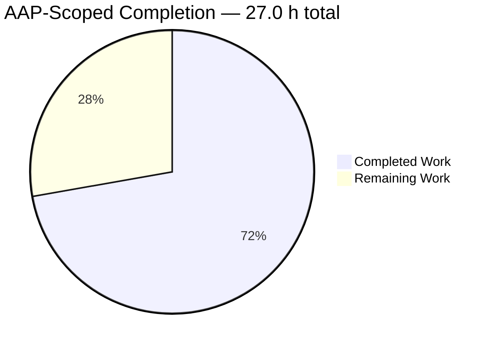

# 1. Executive Summary

## 1.1 Project Overview

A single-file, zero-dependency Node.js HTTP server: the smallest complete server, readable end to end and runnable with one command. `GET /hello` answers `200 text/plain` with the body `Hello world`; every other target or method answers `404 text/plain` with the body `Not Found`. It logs each request before routing it, prints one line at startup, and shuts down cleanly on CTRL+C with exit status `0`. Built on the built-in `http` module alone — no framework, no middleware, no router, no dependency, no lockfile, no install step — it targets beginners following a tutorial and instructors needing a framework-free baseline, and its whole configuration surface is the `PORT` variable.

## 1.2 Completion Status

**72% complete** — 19.5 of 27.0 hours, leaving 7.5 hours: 19.5 ÷ 27.0 = 72%.



| Metric | Hours |
| --- | --- |
| Total Hours | 27.0 |
| Completed Hours (AI + Manual) | 19.5 |
| Remaining Hours | 7.5 |

## 1.3 Key Accomplishments

- [x] Both response contracts verified on the wire and in a browser, at byte level (`server.js:66-85`).
- [x] Exact, case-sensitive routing behind a `GET`-only guard, with the query-string form still matching.
- [x] One ISO-8601 three-token log line per request, written before routing, target as received.
- [x] `PORT` contract: default `3000`, override honoured; ten invalid and eight out-of-range values rejected with exit `1`.
- [x] Bind failures reported as one actionable line each, with no stack trace and no internals in any response.
- [x] Clean lifecycle: one shutdown line, connections released in 7 ms with an idle peer held, port freed.
- [x] README carrying all eight required sections, quoting only strings the server prints; manifest exactly seven fields.
- [x] Delivered as exactly three root files, with no dependency, lockfile, build step or extra artefact.

## 1.4 Critical Unresolved Issues

2 of 23 recorded requirements remain open; both are accepted behaviours outside the request-handling path.

| Issue | Impact | Owner | ETA |
| --- | --- | --- | --- |
| An unwritable standard output (`EPIPE` when the log reader exits, `ENOSPC` on a full device) raises an unhandled write error, so the process dies with a stack trace and exit status `1` instead of reporting one line (`server.js:51, 130`) | An operator who pipes the output into a tool that exits early loses the server; no request, response or shutdown behaviour is otherwise affected | Maintainer | Before release — 2.0 h |
| A scripted burst of 100 or more SIGINTs ends the process with status `130` by the signal's default action, after the graceful shutdown has completed and printed its line | Reachable only from a script that floods signals; a human CTRL+C and a second press both exit `0` in every measured run | Operator | Optional — 1.5 h |

## 1.5 Access Issues

No access issues identified — the project needs only the Node.js runtime and `curl`, both present, and holds no credential or external dependency.

## 1.6 Recommended Next Steps

1. [High] Register an `error` handler on the console streams so a closed pipe cannot kill the process (2.0 h).
2. [High] Settle the signal-flood exit status, or document the residual in the README (1.5 h).
3. [High] Run the contract and lifecycle checks under Node 18.x, or raise the declared floor (2.0 h).
4. [Medium] Re-measure the latency and memory figures on the deployment host (1.0 h).
5. [Medium] Decide the listener's network scope and record the decision where the server binds (1.0 h).

# 2. Project Hours Breakdown

## 2.1 Completed Work Detail

| Component | Hours | Description |
| --- | --- | --- |
| Manifest and repository foundation | 2.0 | `package.json` with the seven specified fields at the supplied values, making `npm start` work; the three-file root layout; the README placeholder replaced in place; no dependency, lockfile or installed tree introduced |
| HTTP core | 6.0 | Port resolution and validation with both rejection messages, per-request logging, WHATWG pathname parsing against a constant base, the single-entry route table, the `GET` method guard, both response contracts and their `Content-Length` framing written by a single `end()` call (`server.js:28-85`) |
| Process lifecycle and interfaces | 4.5 | Connection tracking for shutdown, bind-error reporting for both failure shapes, the SIGINT shutdown sequence with its bounded fallback and idempotence guard, and the bootstrap that wires them together (`server.js:87-185`) |
| Tutorial documentation | 3.0 | The README's eight sections — purpose, prerequisites, installation, execution, testing, expected output, shutdown and `PORT` configuration — with every quoted string cross-checked against what the server prints, including the port-in-use and generic bind-failure messages (`README.md`) |
| Acceptance evidence | 4.0 | The full gate set run and recorded against the delivered tree: both contracts with headers and framing, every target class, the log format, the configuration matrix, both bind-failure shapes, concurrency, latency, memory stability and shutdown with and without a held connection |
| **Total** | **19.5** | |

## 2.2 Remaining Work Detail

| Category | Hours | Priority |
| --- | --- | --- |
| Console-write failure handling — survive an unwritable stdout or stderr with one actionable line and no stack trace, then re-run the contract and shutdown gates | 2.0 | High |
| SIGINT-flood exit status — force the exit after the graceful shutdown completes, or record the residual in the README's shutdown section, then re-run the shutdown gates | 1.5 | High |
| Declared runtime floor — run the contract, lifecycle and configuration gates under Node 18.x, or raise the floor to a supported LTS line in the manifest and the README | 2.0 | High |
| Threshold re-measurement — repeat the latency series and the memory batch on the deployment host under an idle CPU and update the README's figure if it differs | 1.0 | Medium |
| Listener network scope — decide between the default all-interface bind and a restricted one, record the decision where the server binds, and front the process with a reverse proxy if it will be exposed | 1.0 | Medium |
| **Total** | **7.5** | |

## 2.3 Estimation Basis and Confidence

Hours are grounded in the delivered artefacts and the work each represents: 399 inserted lines across three files, eleven top-level functions in `server.js`, a 203-line README whose every quoted string had to be reconciled against the running process, and an acceptance run of 74 executed checks including a 20-sample latency series, a 200-request concurrent run and a 1000-request memory batch. Confidence is high on the completed figures — the code, the documentation and the recorded measurements are all inspectable — and high on four of the five remaining items, whose scope is bounded and already diagnosed. The one item carrying real variance is the runtime-floor decision: verifying on Node 18.x may uncover nothing, or may require a change to a shutdown call and a re-run of the lifecycle gates, so it should be treated as a 2-hour task with an upper bound nearer 4 hours if the floor itself has to move.

# 3. Test Results

The project ships no test framework and no coverage tooling by design, so the suite is the project's own acceptance gate set, executed against the delivered tree with shell and `curl`: **74 checks executed, 74 passed, 0 failed**, plus three browser navigations rendered in headless Chrome. No coverage percentage is claimed because no coverage tool exists in the repository.

| Area / Category | Framework | Tests | Passed | Failed | Coverage | What This Proves |
| --- | --- | --- | --- | --- | --- | --- |
| Response contracts: `GET /hello`, catch-all 404, method guard, `HEAD`, exact matching | Shell + `curl` | 16 | 16 | 0 | Not reported — no coverage tooling | Both contracts hold on the wire: status, `Content-Type: text/plain`, `Content-Length` 11/9, no chunked framing, bodies never reflecting the request |
| Request logging | Shell + `curl` | 6 | 6 | 0 | Not reported | One three-token ISO-8601 line per request, written before routing, target as received, logged while the process is alive |
| `PORT` configuration and validation | Shell + `curl` | 10 | 10 | 0 | Not reported | The default, the override and every accepted boundary work; every rejected value fails with the exact message, exit status `1` and no bind attempt |
| Lifecycle and shutdown | Shell + `curl` | 13 | 13 | 0 | Not reported | Clean start, one shutdown line, connections released, exit status `0`, port freed — with an idle peer held, and with a second signal |
| Bind-failure reporting | Shell + `curl` | 4 | 4 | 0 | Not reported | `EADDRINUSE` and any other bind failure are each one actionable stderr line with exit status `1`, no stack trace and no false "listening" |
| Performance thresholds | Shell + `curl` | 3 | 3 | 0 | Not reported | `/hello` answers inside the 10 ms budget, 200 concurrent requests are all served, and memory stays bounded over 1000 requests |
| Failure hygiene and adversarial targets | Shell + `curl` | 5 | 5 | 0 | Not reported | Percent-encoded, authority-form, asterisk-form and slash-less targets never crash the process, never produce a 5xx and never leak internals |
| Documentation, manifest and repository shape | Shell + `curl` | 17 | 17 | 0 | Not reported | The README documents the real output, `npm start` runs the entry point, the manifest carries exactly the seven fields, and the repository holds exactly the three files |

A headless browser pass over the running server reproduced the two contracts independently: `/hello` returned `200`, `Content-Type: text/plain`, `Content-Length: 11`, no `Transfer-Encoding`, body `Hello world`; `/invalid` returned `404`, `Content-Length: 9`, body `Not Found`, rendered as the server's own text rather than a browser error page; and `/hello?name=student` returned the same `200` body byte for byte. The only console output was two reports of an intended 404 — the browser's automatic `/favicon.ico` request and the `/invalid` document itself — with no JavaScript error and no error document on any screen.

### Not Covered

- **The declared Node.js 18.0.0 floor was never run.** Only Node 22.23.3 exists on the verification machine, so the floor rests on API provenance — no API newer than 18.0.0 is referenced in `server.js` — and not on an execution under 18.x. Before release, run the contract and lifecycle checks under Node 18.x or raise the floor to a supported LTS line.
- **The generic bind-failure branch has no ordinary trigger.** Validation rejects every port below 1024 before any bind, and a genuinely busy port always yields `EADDRINUSE`, so the `Failed to start server on port <port>: <code>` path was reached only with a non-`EADDRINUSE` error injected at the runtime boundary. Confirm it on a host where a bind can fail for another reason.
- **The 5-second bounded shutdown fallback was reached only by fault injection.** Releasing the tracked sockets always completes shutdown in milliseconds, so the fallback that destroys remaining sockets and forces the exit has no natural trigger; a maintainer touching the shutdown path should not assume ordinary traffic exercises it.
- **Console-write failures and scripted signal floods are scripted conditions**, not ordinary operation: an unwritable stdout and a 100-signal burst were both induced deliberately, and both remain open items (Section 1.4).
- **No request was made from another host.** The all-interface bind was observed in the listener's address, not exercised from a remote machine; a firewall or an IPv6 configuration could change what is reachable.
- **Nothing exists to test for TLS, authentication, authorization, rate limiting, request-body handling, static files, health, metrics or tracing** — the project defines none of those surfaces, so no test could cover them.

# 4. Runtime Validation & UI Verification

Every line below was driven against a running instance of the delivered tree and observed directly — through `curl` for the protocol-level facts and through headless Chrome for what a browser actually renders. The instance was started on a private port and stopped afterwards; the port was released when the process exited.

- ✅ **Startup and readiness** — one stdout line naming the port actually bound, empty stderr, the process alive and serving immediately; confirmed on a configured port and on the documented default `3000`.
- ✅ **`GET /hello`** — `HTTP/1.1 200 OK`, `Content-Type: text/plain` with no charset, `Content-Length: 11`, no `Transfer-Encoding`, body `Hello world`; identical status, header and body in Chrome, rendered as plain text with no error page.
- ✅ **`GET /invalid`** — `HTTP/1.1 404 Not Found`, `Content-Type: text/plain`, `Content-Length: 9`, body `Not Found`; in Chrome the server's own body is what renders, not a browser error document.
- ✅ **Query-string route** — `/hello?name=student` answers `200 Hello world` in both `curl` and the browser, while the log records the target as received.
- ✅ **Method guard and `HEAD`** — `POST /hello` with a body answers `404 Not Found` without reading the body; `HEAD /hello` answers `404` with `Content-Type: text/plain` and no body and no `Content-Length`.
- ✅ **Request logging** — one three-token ISO-8601 line per request, written before routing and already present in the captured output while the process was alive; 19 lines for a 19-request live session, no brackets, no interleaving.
- ✅ **`PORT` configuration and rejections** — the override names the port it bound; ten non-digit values and eight out-of-range or privileged values each stop the process before any bind with the exact documented message and exit status `1`.
- ✅ **Bind-failure reporting** — a real `EADDRINUSE` and a non-`EADDRINUSE` bind failure each print exactly one actionable line on standard error with exit status `1` and no stack trace; a SIGINT arriving in that failure window leaves the status at `1` and prints no shutdown line.
- ✅ **SIGINT shutdown** — exit status `0`, exactly one shutdown line, connections released in 7 ms with an idle peer held (far inside the 5-second backstop), port released and immediately rebindable; a second CTRL+C prints nothing further.
- ⚠ **Non-ordinary conditions** — partial: with the log reader gone the process dies on an unhandled write error with a stack trace and exit `1`, and a scripted 100-signal burst ends the process with status `130` after a completed graceful shutdown. Both are open items (Sections 1.4 and 2.2); ordinary operation, including CTRL+C and a second press, exits `0` in every measured run.

Never exercised at runtime: the code under Node 18.0.0 (only Node 22.23.3 exists on the verification machine); the 5-second shutdown fallback without fault injection, because releasing the tracked sockets always completes shutdown in milliseconds; a request from another host, so the all-interface bind was observed in the listener's address rather than driven remotely; and anything for TLS, authentication, authorization, rate limiting, request-body handling, static files, health, metrics or tracing — the project defines no such surface. The generic bind-failure branch likewise has no ordinary trigger here, since a privileged port is refused during validation and a busy port yields `EADDRINUSE`.

# 5. Compliance & Quality Review

## 5.1 Compliance Matrix

| # | Deliverable | Dimension | Status | Progress | Evidence |
| --- | --- | --- | --- | --- | --- |
| 1 | Single-file server entry point | Structure and runtime contract | ✅ Pass | Complete | `server.js` at the repository root, the file `main` and `scripts.start` name; `http` is the only import; no build step (`server.js:8, 164-187`) |
| 2 | Port configuration and validation | Configuration correctness | ✅ Pass | Complete | Default `3000`, digits-only 1024-65535, both rejection messages verbatim, exit status `1`, no bind attempted (`server.js:28-48, 166-172`) |
| 3 | `GET /hello` contract | API compliance | ✅ Pass | Complete | `200`, `Content-Type: text/plain` without charset, `Content-Length: 11`, no `Transfer-Encoding`, body `Hello world`, one `end()` call (`server.js:14-15, 26, 66-74`) |
| 4 | Catch-all 404, method guard and `HEAD` | API compliance | ✅ Pass | Complete | `404` with `Content-Length: 9`; non-`GET` methods take the same path; `HEAD` carries no body and no length; the target is never echoed (`server.js:16, 76-78, 83-85`) |
| 5 | Request logging | Observability standard | ✅ Pass | Complete | One stdout line per request before routing, three single-space tokens, ISO-8601 UTC with milliseconds, raw target (`server.js:50-52, 81`) |
| 6 | Startup and shutdown lifecycle | Operational readiness | ✅ Pass | Complete for the specified contract | One startup line, one shutdown line, `process.exitCode = 0` in the close callback, tracked sockets ended, idempotent handler (`server.js:120-162, 180-182`) |
| 7 | Bind-failure reporting | Error-handling standard | ✅ Pass | Complete | One actionable stderr line for `EADDRINUSE` and one for any other bind failure, exit status `1`, no stack trace, no false "listening" (`server.js:110-118`) |
| 8 | Failure reporting on an unwritable output stream | Error-handling standard | ⚠ Partial | Open item | An `EPIPE` or `ENOSPC` on the console write raises an unhandled error: stack trace and exit status `1` instead of one actionable line (`server.js:51, 130`) |
| 9 | Tutorial documentation | Documentation standard | ✅ Pass | Complete | All eight required sections in order; every quoted string is one the server prints; anchors resolve; no placeholder text (`README.md`) |
| 10 | Manifest and entry-point wiring | Build and packaging | ✅ Pass | Complete | Exactly the seven specified fields at the supplied values; `main` and `scripts.start` name the file that runs (`package.json:1-9`) |
| 11 | Dependency and delivery cleanliness | Supply-chain standard | ✅ Pass | Complete | No dependency or dev-dependency block, no lockfile, no `node_modules`, no build or generated artefact; three root files and nothing else |
| 12 | Code quality and security boundaries | Engineering standard | ✅ Pass | Complete | Purpose-reflecting names, one handler per route outcome behind a dispatcher, comments only where intent is not obvious, consistent formatting, no dead code or placeholder; no dynamic evaluation, no filesystem access, no outbound call, no persistence, constant response bodies (`server.js` whole file) |

## 5.2 AAP & Rule Divergences and Gaps

| # | What the AAP/Rule Required | What Was Delivered Instead | Why It Diverged | Impact | Remediation |
| --- | --- | --- | --- | --- | --- |
| 1 | The component table specifies `trackSockets(server)` for the connection-tracking function | The parameter is spelled `httpServer` (`server.js:99`) | Removing a shadowing hazard required renaming either the locals or the state they write through, and the naming standard — names must reflect purpose — favoured the clearer spelling | None: the function name, its single input and its `Set` output are unchanged, and the call site is untouched | None required; recorded so the spelling is not read as a wiring change |
| 2 | The bootstrap is described as module-scope wiring, with a fixed set of named constants | The wiring lives in a named `startServer()` function (`server.js:164-187`) and two further constants are named — `PARSE_BASE` and `SHUTDOWN_FALLBACK_MS` (`server.js:18, 22`) | Two literals the specification describes in prose read better as named constants in a teaching file, and a named bootstrap keeps the module's last statement to one call | None: the same wiring runs in the same order at module evaluation, and every constant the specification names is present at its value | None required; worth knowing if the module ever grows a second entry path |
| 3 | `README.md` is described as a creation in a workspace that holds no files | The file was replaced in place over a pre-existing 45-byte placeholder carrying the generator's banner (commit `d790f43`) | The workspace was not empty: the base commit tracked that placeholder at the same path, so the deliverable's content replaced it rather than being written fresh | None: the delivered file carries all eight required sections, quotes only real output, and no placeholder text survives | None required; the plan's description of the starting workspace is the inaccurate part |
| 4 | Failures are reported as one actionable line with a non-zero exit status and never as a stack trace | A write to an unwritable stdout or stderr raises an unhandled `'error'` event, so the process dies with a Node stack trace and exit status `1` (`server.js:51, 130`) | The remedy needs a component that handles console write failures, which the specification's component contract excludes and its "add nothing the plan does not state" rule forbids, so the behaviour is accepted rather than fixed | Low: operator-visible only — a log pipeline that closes the pipe takes the server down and the output is a stack trace; no request, response or shutdown behaviour is affected | Either add the stream `error` handler (2.0 h, task 1 in Section 2.2) or supervise the process so a closed reader cannot kill it |
| 5 | SIGINT logs a shutdown message, closes connections cleanly and exits with status `0` | A scripted burst of 100 or more SIGINTs ends the process with status `130` by the signal's default action, after the graceful shutdown has completed and printed its line | The handler runs once and the process is then left to exit naturally so the shutdown line is never truncated; the burst lands during teardown, after the exit code is set, when the disposition is already returning to its default, and the only remedies contradict the natural-exit requirement or force the exit the plan reserves for its backstop | Very low: a human CTRL+C and a second press exit `0` at every interval measured; only a script that floods the signal reaches this | Force the exit once the graceful shutdown completes, or record the residual in the README's shutdown section (1.5 h, task 2 in Section 2.2) |

**Divergence 1 — connection-tracking parameter name.** The specification fixes `trackSockets`' contract: a purpose-bearing name, one input (the server instance) and one `Set` output. The delivered function keeps all three and changes only its parameter's spelling, because the identifiers it writes through — the module's socket set and the server instance it is handed — were the same names its own locals used, so a reader could mistake one for the other. The change is confined to four lines (`server.js:99-108`) and is covered by the shutdown checks that hold an idle connection across the signal: the peer is released, one shutdown line is printed, the exit status is `0` and the port is free.

**Divergence 2 — bootstrap shape and two named constants.** The module's last statement is a call to `startServer()`, which performs the specification's wiring in the specification's order: port resolved, server created with its request handler, connection tracking, error handler, listening line and SIGINT handler registered, then `listen` (`server.js:164-187`). Inside it, the parse base and the fallback interval are named constants rather than inline literals, and `PARSE_BASE` carries the note that the `Host` header is never trusted. Every constant the specification enumerates is present at its value. The only consequence is that a second entry path would call `startServer()` rather than re-run module scope.

**Divergence 3 — how `README.md` came to its content.** The specification describes the workspace as empty and every planned file as a creation. The base commit in fact tracked one file at the README's path: a 45-byte placeholder naming the generator. The delivered documentation replaced it, so the file's first commit is a modification rather than an addition, showing two deleted lines against 203 inserted. The content is unaffected: all eight sections are present, every quoted string is one the server prints, and no placeholder text survives. Nothing needs changing on that account — the record exists so a reader comparing the plan with the history knows why one file is a modification.

**Divergence 4 — an unwritable output stream kills the process.** The failure table names exactly two paths that can fail — port resolution and binding — and requires every failure to reach the operator as one actionable line with a non-zero exit status, never as a stack trace. That holds for both named paths, but not for the console writes: if the reader of the process's output goes away, the next log write raises an unhandled error, the process dies with a stack trace and exit status `1`, and requests in flight go unanswered (`server.js:51, 130`). It stands as delivered because the fix adds a component the file's contract excludes. Supervise the process, or add the handler — task 1 in Section 2.2.

**Divergence 5 — exit status under a signal flood.** SIGINT is contracted to log one line, release connections and exit `0`, and that is what a person gets: a CTRL+C, and a second CTRL+C at any interval, both exit `0` with exactly one shutdown line and connections released in milliseconds rather than waiting on the five-second backstop. What diverges is the scripted extreme — a burst of a hundred or more signals, delivered faster than the process can tear down, ends with status `130` as the remaining signals take the default disposition after the graceful shutdown has run. The remedies contradict the natural-exit requirement; task 2 in Section 2.2 is the decision.

# 6. Risk Assessment

These are forward-looking: what could still go wrong where the project is going to run, not a record of anything already dealt with. The product integrates with nothing outside its own host, so the integration category is empty by construction.

| Risk | Category | Severity | Probability | Mitigation | Status |
| --- | --- | --- | --- | --- | --- |
| An unwritable stdout (a closed log pipe, or a full device) raises an unhandled write error and kills the process with a stack trace rather than reporting one line (`server.js:51, 130`) | Technical | Medium | Low | Add an `error` handler on the two console streams (2.0 h), or supervise the process so a reader that exits cannot take the server down with it | Accepted — open item 1, Section 1.4 |
| A scripted burst of 100 or more SIGINTs ends the process with status `130` after the graceful shutdown has completed | Technical | Low | Low | Force the exit once the shutdown callback has run, or record the residual in the README's shutdown section (1.5 h) | Accepted — open item 2, Section 1.4 |
| The declared runtime floor, Node.js 18, is past end of life and receives no security patches; npm treats the declaration as advisory, so nothing prevents the server being started on it | Security | Medium | High if run on 18.x | Run the server on a supported LTS line, or raise `engines.node` and the README prerequisite and re-run the contract and lifecycle checks (2.0 h) | Accepted — the literal floor is deliberate |
| The listener binds every interface over plain HTTP, with no TLS, authentication, authorization, rate limiting or request-body cap, so any host that can reach the port can use the service and a hostile client can occupy descriptors for roughly a minute and a half | Security | Medium | Medium on an untrusted network | Run it on trusted networks only, restrict the bind, or put a reverse proxy in front (1.0 h) | Accepted — the exposure is documented in the README |
| The latency and memory figures were measured on one shared machine with per-sample connection setup, so they say nothing about the hardware or network the reader will use | Operational | Low | Medium | Repeat the latency series and the memory batch on the target host under an idle CPU and update the README if the result differs (1.0 h) | Open — Section 2.2 |
| With no test files and no test framework in the repository, a future edit to `server.js` has nothing automatically re-checking the two response contracts | Operational | Medium | Medium | Re-run the recorded gate set after any change to the file; adopt a test runner deliberately if the project is ever extended beyond the exercise | Accepted — a test framework is excluded by scope |

# 7. Visual Project Status

Completion colour convention: completed work is shown in the project's Dark Blue (`#5B39F3`), remaining work in White (`#FFFFFF`).


**Completion:** 19.5 h completed of 27.0 h total = **72%**.

**Remaining hours by category** (from Section 2.2):

| Category | Hours | Priority |
| --- | --- | --- |
| Console-write failure handling | 2.0 | High |
| SIGINT-flood exit status | 1.5 | High |
| Declared runtime floor verification | 2.0 | High |
| Threshold re-measurement on the deployment host | 1.0 | Medium |
| Listener network scope decision | 1.0 | Medium |
| **Total remaining** | **7.5** | |

**Priority distribution:** 5.5 h of the remaining work is High priority — the two code-level items and the runtime-floor verification that together decide whether the delivered behaviour can be relied on as contracted — and 2.0 h is Medium priority, covering the two decisions that depend on where the server will run rather than on the code.

# 8. Summary & Recommendations

The project is a complete, working implementation of what it set out to be: three files at the repository root — `server.js`, `package.json`, `README.md` — that together give a beginner the smallest usable Node.js server. Everything the plan asked for is in the tree and was exercised. Both response contracts were verified on the wire and in a browser: `GET /hello` answers `200 text/plain` with `Content-Length: 11` and the body `Hello world`, every other target or method answers `404 text/plain` with `Content-Length: 9` and the body `Not Found`, exact case-sensitive matching holds across thirteen target classes, `HEAD` carries no body and no length, and no response ever carries a request value, an error string, a path or a version. Request logging, the `PORT` contract with both rejection messages, bind-failure reporting, and a shutdown that releases a held connection in milliseconds all behave as documented. Against a record of 74 executed checks the result is 74 passed, 0 failed, with the documentation, the manifest and the repository's shape checked alongside the runtime behaviour. Completion stands at 72% — 19.5 hours of 27.0.

What remains is small in volume and specific in kind. Two behaviours diverge from the contracted failure handling: an unwritable output stream kills the process with a stack trace instead of reporting one line, and a scripted burst of a hundred or more SIGINTs ends the process with status `130` after a completed graceful shutdown. Neither is reachable by a person using the server — CTRL+C and a second CTRL+C both exit `0` — but both are honest gaps, and the first is the one that a real operator can trip by piping the server's output into a tool that exits early. Alongside them, three items are verification and decision work rather than code defects: the declared runtime floor of Node 18 has never been executed (only Node 22 exists on the verification machine, and the floor names a line past end of life), the latency and memory figures come from one shared machine, and the listener's network scope has to be settled by whoever decides where this runs.

The critical path to a release is short and ordered. First make console write failures survivable, because that is the only gap with an operational trigger (2.0 h). Then settle the signal-flood exit status, which is a decision as much as a change: force the exit after the graceful shutdown, or document the residual (1.5 h). Then exercise the declared runtime floor, or move it to a supported line and re-run the contract and lifecycle checks (2.0 h). Those three close every open item and every acceptance claim the delivered files could not settle; the remaining two tasks — re-measuring the thresholds on the deployment host, and deciding the network scope — are preparation for operating the server rather than repair (2.0 h). None of the five touches the request-handling path, and none requires redesigning anything that is currently verified.

Success for this project is measurable and already met in most respects: both contracts correct at byte level and confirmed in a browser, thirteen target classes behaving as documented, every invalid `PORT` value rejected with the exact message and exit status `1`, one log line per request, shutdown in milliseconds with connections released, and exactly three files with no dependency, lockfile or build step. The gaps are the two failure-handling behaviours above and the three verification and decision items, which is why the readiness call is not "unfinished" but "fit for its stated scope, with two known operational edges". A reader adopting this code as a teaching example can rely on everything in Section 1.3 today; a reader deploying it into anything with a supervised log pipeline or an untrusted network should close tasks 1, 3 and 5 before doing so.

The project is production-ready in the sense the plan claims and no more: the code is complete, self-consistent, free of placeholders, dead code and unused state, and it holds its security boundaries structurally rather than by inspection — constant response bodies, no evaluation, no filesystem access, no outbound calls, one validated input and no persistence. It is a deliberately unhardened teaching server: no TLS, no authentication, no rate limiting, no body cap, and an all-interface bind. Those are decisions, not omissions, and they are documented in the README rather than hidden. Close the two failure-handling items, settle the runtime floor, and the deliverable leaves the project with nothing outstanding except the operational choices that belong to whoever runs it.

# 9. Development Guide

## Prerequisites

- **Node.js v18.0.0 or newer.** Check it with `node --version`; the project was verified on v22.23.3. The declared floor lives in `package.json` under `engines.node`, and npm treats it as advisory — the README's prerequisites section is the statement that matters.
- **`curl` for the verification steps below.** Any HTTP client works; the examples use `curl` because it is one command with no setup.
- Nothing else: no compiler, no build tool, no database, no service. Hardware and operating system are irrelevant beyond Node running on them.

## Environment Setup

```bash
# 1. Get the project — the repository root IS the application layout
cd <repository-root>
ls -1
# README.md
# package.json
# server.js

# 2. There is no install step. Do not run npm install: the project declares no
#    dependencies and an install would write a lockfile it deliberately does not carry.
```

The only configuration input is the `PORT` environment variable. Nothing else is read: no configuration file, no `.env`, no command-line flag. The repository carries no `.gitignore`, so if you redirect the server's output to a file while working, write it somewhere of your own choosing and keep it out of any commit.

## Syntax Check

```bash
node --check server.js
# silent, exit status 0
```

This is the whole build step. There is no transpile, no bundler and no output directory.

## Run the Server

```bash
# Default port 3000
node server.js
# Server listening on port 3000

# Or on a port of your choosing
PORT=4000 node server.js
# Server listening on port 4000
```

The same thing through npm, which echoes the command it runs above the server's line:

```bash
npm start

> nodejs-tutorial-hello-world@1.0.0 start
> node server.js

Server listening on port 3000
```

The server stays in the foreground and serves requests until you stop it. The number in the startup line is the port actually bound, so it changes when you set `PORT`.

## Verify It Works

With the server running in one terminal:

```bash
curl http://localhost:3000/hello
# Hello world

curl -i http://localhost:3000/hello
# HTTP/1.1 200 OK
# Content-Type: text/plain
# Date: <request time>
# Connection: keep-alive
# Keep-Alive: timeout=5
# Content-Length: 11
#
# Hello world

curl -i http://localhost:3000/invalid
# HTTP/1.1 404 Not Found
# Content-Type: text/plain
# Content-Length: 9
#
# Not Found

# Status code only, and a latency sample
curl -s -o /dev/null -w '%{http_code}\n' http://localhost:3000/hello        # 200
curl -s -o /dev/null -w '%{time_starttransfer}\n' http://localhost:3000/hello  # ~0.0006
```

Use the port you actually started on in every URL. A query string changes nothing about routing — `curl http://localhost:3000/hello?name=student` is the same `200 Hello world` — and `HEAD /hello` is the catch-all `404` with no body and no `Content-Length`, because the route is served for `GET` only.

## Inspect the Log

The terminal running the server prints one line per request, before routing it:

```text
Server listening on port 3000
2026-10-18T13:06:39.482Z GET /hello
2026-10-18T13:06:41.007Z GET /invalid
2026-10-18T13:06:42.115Z POST /hello
```

Three single-space-separated fields and no brackets: an ISO-8601 UTC timestamp with millisecond precision, the HTTP method, and the request target exactly as the client sent it. 404s are logged exactly like successes.

## Stop the Server

Press CTRL+C in the terminal where it is running:

```text
Server shutting down on port 3000
```

The process exits with status `0`, open connections are released as part of the shutdown — so a browser tab or an idle client cannot make the stop hang — and the port is free as soon as the process has exited. Pressing CTRL+C a second time while the shutdown is running prints nothing further.

In a script, signal the `node` process and not npm's pid: `npm start` runs the server under a shell wrapper, so a signal sent to npm's own pid does not reach it.

```bash
# Find the node process that owns the port, then signal it
kill -INT "$(lsof -ti :3000)"
```

## Troubleshooting

| Symptom | Message | Cause | Resolution |
| --- | --- | --- | --- |
| The server will not start | `Invalid PORT "abc": expected an integer between 1024 and 65535.` | `PORT` is set but is not written as plain decimal digits — the same applies to `3e3`, `0xBB8`, `+3000`, `3000.0` and a value with surrounding spaces | Unset `PORT` for the default, or give a digits-only value in 1024-65535. Exit status is `1` and nothing is bound. |
| The server will not start | `Invalid PORT "70000": must be between 1024 and 65535.` | `PORT` is a valid number but outside the accepted range, which is also why privileged ports such as `80` are refused | Choose a port in 1024-65535. Exit status is `1` and no bind is attempted, so the operating system never reports a permission error. |
| The server will not start | `Port 3000 is already in use. Set a different PORT and try again.` | Something else already holds the port — often a previous instance, or another service on the machine | Set a different `PORT`, or stop the process that holds it (`lsof -ti :3000`). Exit status is `1`, with no stack trace. |
| The server will not start | `Failed to start server on port 3000: EACCES` | The port could not be bound for a reason other than being busy, such as the operating system refusing it | Read the error code beside the port: it is the system's own reason. Exit status is `1`, with no stack trace. |
| `curl` cannot connect | `curl: (7) Failed to connect` | The server is not running, or you are requesting a different port from the one in its startup line | Check the startup line for the port bound, and that the process is still alive. |
| Requests return `404` unexpectedly | — | Routing is exact and case-sensitive: `/hello/`, `/HELLO`, `/hello/extra` and `/` are all `404` by design, and `/hello?name=student` is a `200` | Request `/hello` exactly. A leading `//` is also a `404`, because it parses as an authority rather than a path. |
| The process dies while you pipe its output | `Error: write EPIPE` with a stack trace | Something downstream of a pipe closed early, and the server has no handler for a failed console write — an open item (Section 1.4) | Keep the reader open for the life of the process, or run the server with its output to a file or a supervisor. |
| A browser reports no favicon | — | There is no static-file route; the browser's automatic `/favicon.ico` request is answered by the catch-all `404` and appears in the log | Expected. Serving one would mean adding a static route, which is out of scope. |
| You cannot reach the server from another machine | — | The listener binds every interface by default, so what blocks you is a firewall or a network policy, not the bind | Check the host's firewall. The bind scope itself is a decision recorded in Section 2.2. |

## Example Usage

```bash
# A complete session from a clean checkout, with the log kept in a scratch file
cd <repository-root>
node --check server.js                       # silent, exit 0
PORT=4000 node server.js > ~/server.log 2>&1 &
SRV=$!
sleep 1
curl -s http://localhost:4000/hello          # Hello world
curl -s http://localhost:4000/invalid        # Not Found
curl -s http://localhost:4000/hello?name=student   # Hello world
kill -INT $SRV
cat ~/server.log
# Server listening on port 4000
# 2026-10-18T13:06:39.482Z GET /hello
# 2026-10-18T13:06:41.007Z GET /invalid
# 2026-10-18T13:06:42.115Z GET /hello?name=student
# Server shutting down on port 4000
```

To extend the example with a second route, add one entry to the route table and one handler function beside `handleHello` in `server.js`: dispatch reads the table with the parsed pathname and falls through to the catch-all, so a new route needs nothing else. Re-run the verification steps above afterwards — the repository carries no automated test suite.

# 10. Appendices

## A. Command Reference

| Purpose | Command |
| --- | --- |
| Check the runtime version | `node --version` |
| Check the package manager | `npm --version` |
| Syntax-check the application | `node --check server.js` (silent, exit 0) |
| Start on the default port | `node server.js` |
| Start on a chosen port | `PORT=4000 node server.js` |
| Start through npm | `npm start` |
| Request the success route | `curl http://localhost:3000/hello` |
| Request with headers shown | `curl -i http://localhost:3000/hello` |
| Request the catch-all | `curl http://localhost:3000/invalid` |
| Status code only | `curl -s -o /dev/null -w '%{http_code}\n' http://localhost:3000/hello` |
| Latency sample | `curl -s -o /dev/null -w '%{time_starttransfer}\n' http://localhost:3000/hello` |
| A non-GET request | `curl -X POST -d 'x=1' http://localhost:3000/hello` |
| A HEAD request | `curl -I http://localhost:3000/hello` |
| Concurrent load | `seq 1 200 \| xargs -P8 -I{} curl -s -o /dev/null -w '%{http_code}\n' http://localhost:3000/hello` |
| Memory sample | `ps -o rss= -p <node pid>` |
| Stop the server | CTRL+C, or `kill -INT <node pid>` |
| Find the process on a port | `lsof -ti :3000` |
| Check whether a port is bound | `ss -lnt \| grep ':3000'` |
| Confirm no dependency was introduced | `grep -E '"(dependencies\|devDependencies)"' package.json; ls package-lock.json node_modules` |

## B. Port Reference

| Port | Use |
| --- | --- |
| `3000` | The default the server binds when `PORT` is unset, and the port every README example uses |
| `1024`-`65535` | The accepted range for `PORT`; a digits-only decimal string |
| Below `1024` | Refused during validation, before any bind attempt, so no permission error is ever raised |
| Above `65535` | Refused during validation with the out-of-range message |
| Any port already in use | Reported as `Port <port> is already in use…` with exit status `1` |

The listener binds every interface the host has: `server.listen(port)` is called with no host argument, so the address appears as `*:<port>` and the port is reachable on every interface, not just loopback. The README states this where it documents execution. Nothing else in the project opens a port, and no outbound connection is ever made.

## C. Key File Locations

| Path | Role |
| --- | --- |
| `server.js` | The entire application — the only file that runs. Constants, port resolution and validation (`28-48`), request logging (`50-52`), target parsing (`54-64`), response writing (`66-70`), the two handlers and the dispatcher (`72-85`), module state (`90-93`), connection tracking (`99-108`), bind-error reporting (`110-118`), the SIGINT shutdown (`120-162`) and the bootstrap (`164-187`) |
| `package.json` | The manifest: name, version, description, `main`, `scripts.start` and the `engines.node` floor — and no dependency block |
| `README.md` | The tutorial: purpose, prerequisites, installation, execution, testing, expected output, shutdown and `PORT` configuration |
| `server.js:26` | The route table — one entry, `/hello`, and the place a second route would be added |
| `server.js:14-18` | The constants a reader is most likely to want to change: the content type, both response bodies and the shutdown fallback interval |

## D. Technology Versions

| Component | Version | Notes |
| --- | --- | --- |
| Node.js | Verified on v22.23.3; declared floor `>=18.0.0` | The floor is declared literally in `package.json` and stated in the README. No API newer than 18.0.0 is referenced — connections are released by ending tracked sockets rather than with `closeIdleConnections()`/`closeAllConnections()`, which arrived in 18.2.0 |
| npm | 11.21.0 | Used only to run `npm start`; the project installs nothing and treats the engine floor as advisory |
| `curl` | 8.14.1 | The verification client for every request in this guide |
| JavaScript | ES2020 syntax, CommonJS | No `"type"` field in the manifest, so `server.js` loads with `require` and no transpilation |
| Dependencies | None | The only import is the built-in `http` module; there is no lockfile and no installed tree |
| Test framework, linter, formatter | None | Deliberately absent: the project is verified by running the commands in Section 9 and the gate set in Section 3 |

## E. Environment Variable Reference

| Variable | Required | Default | Accepted values | Effect |
| --- | --- | --- | --- | --- |
| `PORT` | No | `3000` | A whole number written as decimal digits, from `1024` to `65535` | The port the server binds. Read once, at startup, from the process environment. An unset variable means the default; a value that is not digits-only, or that falls outside the range, stops the process before it binds with one actionable line on standard error and exit status `1` |

No other environment variable is read. There is no configuration file, no `.env` loading and no command-line flag. The project declares no secrets and no pre-applied environment configuration.

## F. Developer Tools Guide

| Task | Tool | Command |
| --- | --- | --- |
| Edit the application | Any text editor | `server.js` is one file with no build step, so a save is the whole edit-compile cycle |
| Check syntax before running | Node's built-in check | `node --check server.js` |
| Exercise the HTTP surface | `curl` | See Section 9; `-i` shows the status line and headers, `-w` extracts a single value such as the status code or the time to first byte |
| Drive the surface from a browser | Any browser | Open `http://localhost:3000/hello`; the response is plain text, so it renders as a bare line with no page chrome |
| Watch the request log | The terminal running the server | One line per request, printed as the request arrives |
| Confirm the process is listening | `ss` or `lsof` | `ss -lnt` for the listener list, `lsof -ti :3000` for the pid that owns the port |
| Stop a backgrounded instance | `kill` | `kill -INT <node pid>`; signal the node process rather than npm's pid |
| Measure a change's effect on latency | `curl` write-out | `curl -s -o /dev/null -w '%{time_starttransfer}\n' http://localhost:3000/hello`, repeated, discarding the first sample |
| Measure memory after a change | `ps` | `ps -o rss= -p <node pid>` before and after a batch of requests |
| Guard a change | The gate set behind this guide | Re-run the checks in Sections 3 and 9 after any edit: the repository intentionally carries no test framework, so nothing else will catch a regression |

There is no linter, formatter or type checker in the project, and none is needed: `node --check` and the request checks are the available signals, and the code is written in one consistent style rather than enforced into it.

## G. Glossary

| Term | Meaning |
| --- | --- |
| **AAP-scoped completion** | The share of the work this project was scoped to do, plus the steps needed to put it into service, that is finished — measured here in hours: 19.5 of 27.0, or 72% |
| **Catch-all** | The single handler that answers everything the route table did not match, always with `404` and the constant body `Not Found` |
| **Content-Length framing** | Sending the body length as a header so a client knows where the response ends. The server gets this for free by writing the whole body in one `end()` call, which is also why no chunked framing appears |
| **EADDRINUSE** | The operating system's error for "that port is already bound", reported here as one actionable line with exit status `1` |
| **EPIPE** | The error raised when writing to a pipe whose reader has gone away; the one condition that still kills the process (open item, Section 1.4) |
| **Graceful shutdown** | Stopping the listener, releasing open connections and letting the process exit on its own so the shutdown line is never truncated |
| **Keep-alive** | Reusing one TCP connection for several requests; an idle keep-alive socket is why shutdown tracks connections rather than relying on the listener alone |
| **Pathname routing** | Comparing the parsed pathname — not the raw request target — with the route key, which is why a query string does not defeat the route |
| **SIGINT** | The signal a terminal sends when you press CTRL+C; the only signal this server handles |
| **Tracked socket** | A live connection added to the shutdown set when it opens and removed when it closes, so shutdown can release it explicitly |
| **WHATWG `URL`** | The standard URL parser used to reduce a request target to a pathname, against a constant base, so the client's `Host` header can never influence how its own target is interpreted |
