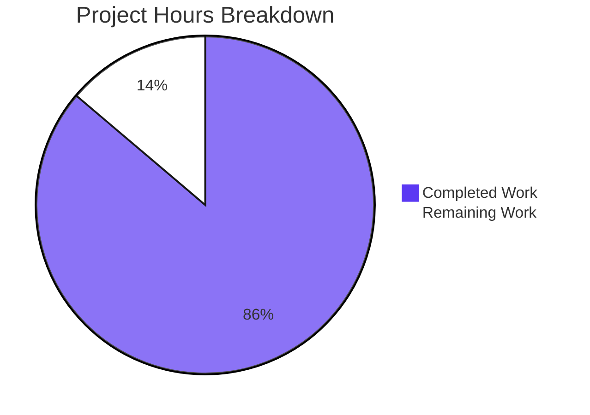

# 1. Executive Summary

## 1.1 Project Overview

A single-file, dependency-free Node.js HTTP server written as a teaching reference: `server.js` serves `GET /hello` with `Hello world` and answers every other request with `404 Not Found`, using Node.js's built-in `http` module and nothing else. It serves beginners learning request handling and tutorial maintainers who need a canonical example. Scope: one process, one route table with a single entry, two constant response bodies, three stdout lifecycle lines, one configuration input (`PORT`) and one twelve-test harness — no framework, no build step, no installed dependency and no data store.

## 1.2 Completion Status

**86% complete.** Completed hours ÷ total hours = 75 ÷ 87, counting only the work this project was scoped against. Completed work is dark blue (`#5B39F3`); remaining work is white (`#FFFFFF`).



| Metric | Hours |
|---|---|
| Total Hours | 87 |
| Completed Hours (AI + Manual) | 75 |
| Remaining Hours | 12 |

## 1.3 Key Accomplishments

- `GET /hello` answers `200 text/plain`, `Content-Length: 11`, body `Hello world` — verified on the wire.
- Every other method and path answers `404 text/plain Not Found`, including the bodyless `HEAD` case.
- Routing is exact, case-sensitive and method-aware through one `Map` route table (`server.js:108-134`).
- Each request logs one `[<ISO-8601 UTC>] <METHOD> <path>` stdout line before routing, unmatched requests included.
- `PORT` is validated as digits in 1024–65535, defaults to 3000, and every rejection exits 1 with an actionable message.
- `SIGINT` logs `Server shutting down`, releases idle keep-alive sockets and exits 0.
- A twelve-gate `node:test` harness re-runs the whole contract against the real server: 12 of 12 pass.
- `README.md` carries a beginner from prerequisites to a verified transcript and a clean stop.

## 1.4 Critical Unresolved Issues

**4 of the 41 scoped requirements carry open follow-up work**; the other 37 are verified.

| Issue | Impact | Owner | ETA |
|---|---|---|---|
| Two verified behaviours are asserted by no test: the non-`EADDRINUSE` bind-failure message (`server.js:176-179`) and the leading-zero `PORT=03000` spelling | A future edit to either literal would pass `npm test` | Application owner | 3 h |
| The default-port gate binds host-global port 3000, and three socket awaits in the harness carry no timeout budget (`test/server.test.js:65-80, 537-566, 605-640`) | On a shared or CI host, `npm test` can fail for the host rather than the code | Application owner | 5 h |
| The declared Node 18.0.x/18.1.x floor cannot be exercised on the runtime available: the guarded `closeIdleConnections()` call and the force-exit guard are covered by design, not by observation (`server.js:212-220`) | A floor-specific shutdown regression would be invisible here | Application owner | 3 h |
| The declared floor `engines.node` `">=18.0.0"` admits an end-of-life line that receives no further security patches (`package.json:11`) | Anyone deploying on the floor runs unpatched code | Deployment owner | 1 h |

## 1.5 Access Issues

No access issues identified: no credential, service or network egress is required.

## 1.6 Recommended Next Steps

1. **[High]** Fix the runtime any deployment will use, and keep the README's floor statement in step (1 h).
2. **[Medium]** Make `npm test` independent of the host: decouple the default-port gate and bound the harness's socket awaits (5 h).
3. **[Medium]** Exercise the declared Node 18.x floor on a real 18.x runtime (3 h).
4. **[Low]** Give the non-`EADDRINUSE` message and the leading-zero `PORT` spelling a documented check (3 h).

# 2. Project Hours Breakdown

## 2.1 Completed Work Detail

Completed hours are the sum of the eleven components below. Each traces to a requirement this project was scoped against; partial work is discounted by its completed fraction, and there is none to discount — every component below is delivered and verified, with the coverage qualifications carried in Section 2.2 rather than hidden in these figures.

| Component | Hours | Description |
|---|---|---|
| Package manifest | 2 | The seven fixed metadata fields, `scripts.start`, `scripts.test` and the `engines.node` floor, with no dependency declared (`package.json`) |
| Port configuration and validation | 5 | `parsePort`'s digit-string predicate, the 3000 default for an unset or empty value, the inclusive 1024–65535 range, numeric reading of leading zeros, and refusal of every privileged port through the same lower bound with no override (`server.js:11-39`) |
| Endpoint contract and routing | 10 | Method-first route table, exact case-sensitive matching on the query-stripped pathname, both handlers, one response helper, and `Content-Length` 11 and 9 computed by the runtime (`server.js:80-134`) |
| Request and lifecycle logging | 4 | One fixed-format stdout line per request emitted before route handling, the startup line from the listen callback, and the shutdown line on the signal (`server.js:63-64, 122-123, 162, 203`) |
| Shutdown and lifecycle | 5 | `SIGINT` handling, close-callback exit 0, the feature-tested `closeIdleConnections()` release, the unref'd force-exit guard, and the re-entry guard that keeps the shutdown line idempotent (`server.js:188-221`) |
| Bind-failure reporting | 3 | The error listener registered before a host-less `listen`, the three actionable stderr literals and exit status 1 (`server.js:150-183`) |
| Security and minimalism boundaries | 3 | Single built-in import, no dynamic evaluation, filesystem or outbound reach, no persistence, two constant response bodies, and no dependency or tooling to install (`server.js:9, 80-104`) |
| Performance and memory properties | 4 | The structurally I/O-free handler, warmed sub-millisecond round trips, fifty-way concurrency, plateauing resident memory and the documented manual memory gate |
| Code-quality conformance | 3 | Purpose-reflecting naming, modular handlers, comments only on non-obvious decisions, consistent formatting across all four files, no dead code and no placeholders |
| Verification harness | 24 | The built-in `node:test` harness: five helpers and twelve gate tests covering the endpoint, the catch-all, the method mismatch, the query strip, logging, startup, the default port, `SIGINT`, invalid and occupied ports, concurrency and latency (`test/server.test.js`) |
| Documentation | 12 | The reader-level guide: purpose, both version floors, the no-install statement, both run commands, verified `curl` transcripts, the `PORT` table, stop instructions, troubleshooting, the harness section and the manual memory gate (`README.md`) |
| **Total** | **75** | |

## 2.2 Remaining Work Detail

Twelve hours remain. They close the evidence gaps this project leaves open and the runtime decision its pinned floor defers; no scoped behaviour is unimplemented.

| Category | Hours | Priority |
|---|---|---|
| Runtime-floor decision and documentation upkeep: fix the runtime any deployment will use, and keep the README's floor statement, transcripts and measured figures in step with it | 1 | High |
| Test-suite reliability on shared and CI hosts: make the default-port gate independent of a host-global port and give the harness's three socket awaits a timeout budget, so `npm test` reports the code's health rather than the host's | 5 | Medium |
| Declared-runtime verification: run the idle-keep-alive `SIGINT` probe on a real Node 18.0.x/18.1.x runtime to observe the guarded `closeIdleConnections()` branch and the force-exit guard the floor depends on | 3 | Medium |
| Coverage for two hand-verified behaviours: the non-`EADDRINUSE` bind-failure message and the leading-zero `PORT` spelling, by a documented manual check or by extending the harness beyond its twelve-test ceiling | 3 | Low |
| **Total** | **12** | |

75 completed hours + 12 remaining hours = 87 total project hours; 75 ÷ 87 = **86% complete**.

# 3. Test Results

Every test below was executed against the delivered code and the result observed: `npm test` (that is, `node --test test/server.test.js`) exits 0 with **12 tests, 12 passed, 0 failed, 0 skipped, 809–813 ms** on the runtime in place. The runtime battery below the table was driven by hand against a server process started on a free port, with stdout, stderr and exit status captured separately.

| Area / Category | Framework | Tests | Passed | Failed | Coverage | What This Proves |
|---|---|---|---|---|---|---|
| Hello endpoint (`T1`) | node:test | 1 | 1 | 0 | not measured | `GET /hello` returns `200`, `Content-Type: text/plain` with no charset, `Content-Length: 11` and the body `Hello world` on the real wire |
| Catch-all routing (`T2`, `T3`) | node:test | 2 | 2 | 0 | not measured | Unknown paths, the trailing-slash and upper-case variants, and `POST`/`HEAD /hello` all reach the catch-all; a `HEAD` response is bodyless and unframed |
| Query-string handling (`T4`) | node:test | 1 | 1 | 0 | not measured | `GET /hello?x=1` matches `/hello` and is logged with the query stripped |
| Request logging (`T5`) | node:test | 1 | 1 | 0 | not measured | Every request emits exactly one line in the fixed `[<ISO-8601 UTC>] <METHOD> <path>` format, in request order |
| Startup, default port, shutdown (`T6`, `T8`, `T7`) | node:test | 3 | 3 | 0 | not measured | The startup line names the bound port, an absent or empty `PORT` binds 3000, and `SIGINT` prints the shutdown line and exits 0 |
| Configuration (`T9`, `T10`) | node:test | 2 | 2 | 0 | not measured | Every rejected `PORT` spelling exits 1 with the exact range message, and an occupied port exits 1 with the exact address-in-use message |
| Concurrency and latency (`T11`, `T12`) | node:test | 2 | 2 | 0 | not measured | Fifty simultaneous requests are all answered, and the warmed minimum round trip stays well inside the 10 ms budget |
| **Total (`npm test`)** | node:test | **12** | **12** | **0** | not measured | The project's whole automated verification surface, which the twelve tests above are |

**Runtime checks exercised outside the suite:** the `400`/`404`/`HEAD` response bytes read with `od -c`; the startup line for ports 3000, 4000 and a free port; all ten rejected `PORT` spellings and an occupied port with their exit statuses and stderr text; `npm start` reaching the endpoint; fifty concurrent requests tallied with `uniq -c` (`50 200`); twenty warmed timings whose minimum was 0.000266 s; and the documented memory loop, which read 47,668 → 58,296 → 59,056 → 59,356 kB over 2,500 requests. Static checks: `node --check` clean on both JavaScript files, and no dependency field, `node_modules`, lockfile or `.env` present.

**Not covered — deliver a check for these before release:**

- **The non-`EADDRINUSE` bind-failure message** (`server.js:176-179`). No test asserts it, and it cannot be provoked inside the accepted 1024–65535 range on an ordinary host: a privileged port is refused by the range check first, a low file-descriptor limit aborts the runtime before the bind, and `listen()` takes no host argument. A future edit to that literal would pass `npm test`.
- **The leading-zero `PORT` spelling** (`PORT=03000`, which binds port 3000). Verified by hand, asserted by no test, because exercising it in the suite would bind the host-global default port.
- **The memory-stability property.** The documented manual loop is the only check; nothing in the suite fails if resident memory ever tracks the request count.
- **The documentation gates themselves.** That a reader who knows nothing about the project can run, verify and stop the server from `README.md` alone is a judgement, not an assertion.
- **The Node 18.0.x/18.1.x shutdown path.** The guarded `closeIdleConnections()` call (`server.js:212-214`) and the unref'd force-exit guard (`server.js:218-220`) exist for that floor and cannot be exercised on a newer runtime, where `close()` already releases idle keep-alive sockets.
- **Request shapes the runtime answers before routing.** A malformed request line or an oversized header gets the runtime's own `400`/`431` with no log line, and `CONNECT` is intercepted as a tunnel; the single logging point sits in the request handler by design.

# 4. Runtime Validation & UI Verification

Status indicators: ✅ Operational | ⚠ Partial | ❌ Failing.

- ✅ **Startup and bound port** — `Server listening on port <port>` is printed after the bind, naming the port actually bound; with `PORT` unset the process binds 3000 and `ss -ltn` shows `LISTEN 0 511 *:3000 *:*`, the all-interfaces bind.
- ✅ **`GET /hello` on the wire** — `HTTP/1.1 200 OK`, `Content-Type: text/plain` with no charset, `Date`, `Content-Length: 11`, body `Hello world`; `od -c` shows the body ends at `d`, with no trailing newline.
- ✅ **Catch-all, method mismatch and `HEAD`** — `/invalid`, `/hello/`, `/HELLO` and `/` each answer `404` with 9 bytes of `Not Found`; `POST /hello` answers `404`; `HEAD /hello` answers `404` with `Content-Type` and `Date` and neither `Content-Length` nor `Transfer-Encoding`.
- ✅ **Query-string handling** — `GET /hello?x=1` answers `200` and is logged as `/hello`.
- ✅ **Request logging** — 1,078 captured lines across every run, each matching `[<ISO-8601 UTC>] <METHOD> <path>`; one line per request in request order, unmatched requests included, and not one line carrying a query string.
- ✅ **Configuration and failure messages** — `PORT` override, the 3000 default for an unset or empty value, `03000` read as 3000, all ten rejected spellings (including `80`) exiting 1 with empty stdout and the byte-exact range message, and an occupied port exiting 1 with the byte-exact address-in-use message.
- ✅ **Shutdown** — `kill -INT` produces exactly one `Server shutting down` line as the last output, exit status 0, an empty stderr and a released port; a repeated signal is a no-op.
- ✅ **Concurrency and latency** — fifty simultaneous requests all answered `200`; twenty warmed round trips with a minimum of 0.000266 s against the 10 ms budget.
- ✅ **`npm start` and the manual memory-stability check** — the manifest's start script reaches the endpoint and answers `Hello world`; the documented memory loop reads 47,668 → 58,296 → 59,056 → 59,356 kB over 2,500 requests, a plateau rather than growth.
- ⚠ **Non-`EADDRINUSE` bind failure, and the Node 18.0.x/18.1.x shutdown path** — the first is unreachable inside the accepted port range on an ordinary host (a privileged port is refused by the range check, and a low file-descriptor limit aborts the runtime before the bind); the second belongs to a runtime that cannot be installed here. Both are covered by reading the code that implements them, not by observation.

**Never exercised at runtime:** the two paths above; requests that the HTTP parser refuses before routing, which the runtime answers with its own `400`/`431` and no log line; and any response shape outside the two the contract defines. Everything else the product does was driven here.

**Interface surface:** this project renders no user interface — both response bodies are plain text and all lifecycle output is terminal lines. There are accordingly no screens, no client-side scripts and no browser-driven journey to verify; the interfaces a user actually touches are the two HTTP responses and the four terminal lines, and all of those were exercised.

# 5. Compliance & Quality Review

## 5.1 Compliance Matrix

| # | Deliverable / Requirement Group | Benchmark | Status | Progress |
|---|---|---|---|---|
| 1 | Deliverable set: `server.js`, `package.json`, `README.md`, `test/server.test.js` | Every planned file present at its planned path, nothing else added | ✅ PASS | 100% |
| 2 | Endpoint contract: `GET /hello` → `200 text/plain Hello world`; any other method and path → `404 text/plain Not Found` | Behaviour matches the declared contract byte for byte on the wire | ✅ PASS | 100% |
| 3 | Routing precision: exact, case-sensitive, method-aware, query string stripped before matching and logging | `/hello/`, `/HELLO` and `POST`/`HEAD /hello` fall through; `/hello?x=1` matches and logs `/hello` | ✅ PASS | 100% |
| 4 | Configuration contract: `PORT` from the environment, default 3000, digits only in 1024–65535, leading zeros numeric, no privileged-port override | Every accepted and rejected spelling behaves as declared | ✅ PASS | 100% |
| 5 | Failure reporting: one actionable stderr line and exit status 1 on invalid configuration and on a bind failure | Both named literals exact at runtime; the non-`EADDRINUSE` message implemented but asserted by no test (Section 3) | ✅ PASS | 90% |
| 6 | Logging and lifecycle: one stdout line per request before routing, the startup line after the bind, the shutdown line and exit 0 on `SIGINT` | All four observed with the streams, wording and ordering declared | ✅ PASS | 100% |
| 7 | Manifest: the fixed metadata fields, both scripts, the engines floor, no declared dependency | Field-by-field check exact; no dependency field of any kind | ✅ PASS | 100% |
| 8 | Documentation: a zero-knowledge reader can run, verify, reconfigure and stop the server unaided | Content set present and the path replayed end to end with the documented output | ✅ PASS | 100% |
| 9 | Performance and concurrency: warmed `/hello` under 10 ms; fifty concurrent requests served without blocking | Warmed minimum 0.000266 s; fifty concurrent requests all answered `200` | ✅ PASS | 100% |
| 10 | Memory stability under repeated requests | Documented manual gate held: a plateau across 2,500 requests rather than growth | ✅ PASS | 100% |
| 11 | Security and minimalism: no dynamic evaluation, filesystem or outbound reach, no persistence, no internal detail in a response; built-in modules only, single file | Every boundary verified by reading the code and by grep; no dependency, lockfile or configuration file exists | ✅ PASS | 100% |
| 12 | Code quality: purpose-reflecting names, modular handlers, decision-only comments, consistent formatting, no dead code or placeholders | Zero placeholders, zero style defects and a clean syntax check across all four files | ✅ PASS | 100% |

## 5.2 AAP & Rule Divergences and Gaps

Five divergences were identified. None blocks the product: each is a departure from what was agreed, recorded here because the reader is entitled to know it, not because the delivered code is wrong. No user-specified rules exist for this project, so no rule was departed from and the table below is AAP-only.

| # | What the AAP/Rule Required | What Was Delivered Instead | Why It Diverged | Impact | Remediation |
|---|---|---|---|---|---|
| DV1 | T5 asserts "the log-line format and its ordering before the response" | T5 asserts the format, the count and the request order, and records the emission point as the code-level property it is (`test/server.test.js:417-419`) | A harness that awaits the response before reading stdout cannot observe the emission point, so T5 asserts what its assertions can fail on | None on the product: the line is written before route handling (`server.js:122-123`) and unmatched requests are logged | None required |
| DV2 | `README.md` recorded as a file to be created | Delivered as an in-place replacement of the 45-byte placeholder already tracked at that path | The path was not empty, so the file was written over it rather than created | None: the required content set is present in full | None required |
| DV3 | The component table lists twelve components | The file carries a thirteenth declaration, the module-scope `isShuttingDown` boolean (`server.js:188`) | A repeated `SIGINT` would otherwise print the shutdown line again; the flag makes it a no-op and holds the exit path to one order | A boolean written at most once per process; it holds no request data and cannot grow | None required |
| DV4 | `engines.node` is `">=18.0.0"` and every manifest field keeps its pinned value | The floor is unchanged; the README states the floor's end-of-life consequence and points at Node.js 22.x LTS (`README.md:36-39`) | The pinned value is the request's own and outranks the general warning it triggers | The declared floor admits an interpreter that receives no further security patches | Decide and record the deployment runtime (Section 2.2, 1 h) |
| DV5 | The acceptance criteria quote an illustrative memory series, and the failure-message table writes the code as `<err.code or err.message>` | The README carries the readings measured on a real checkout (≈47/≈58/≈59 MB) and renders that message's code as `<code>` (`README.md:248, 297-302`) | Documentation must match what the code and runtime actually do; no non-`EADDRINUSE` bind failure is reachable inside the accepted port range | None on behaviour; a reader comparing the README against an older draft sees different numbers and a masked error code | Keep the figures and transcripts in step when any literal changes (Section 2.2) |

**DV1 — the log-ordering assertion.** The product logs at `server.js:122-123`, before the route table is consulted at `server.js:125-126`, and a request to an unmatched path is still logged — both observable in any run. What T5 owns is the line's format, its count and its order relative to the other requests, which is what a child-process test can refute; the emission point is stated at the test as the code-level property it is (`test/server.test.js:417-419`). Nothing a reader relies on changes, and the README's description of the server at `README.md:267-269` stays accurate because it describes the product rather than the test.

**DV2 — the README written over a placeholder.** The plan assumed an empty workspace, which is why it records the documentation as a new file. The path was not empty: a 45-byte placeholder was already tracked there. It was replaced wholesale, and the result satisfies the same requirement — purpose, both version floors, the no-install statement, both run commands, verified `curl` transcripts, the `PORT` table, stop instructions, troubleshooting, the harness section and the manual memory gate (`README.md:3-305`). A reader opening the file finds a complete guide, and no second documentation file, `docs/` directory, badge or licence file was added.

**DV3 — the thirteenth declaration.** `isShuttingDown` (`server.js:188`) exists so that a second `SIGINT` arriving while `close()` waits on an in-flight connection cannot print a second `Server shutting down` line or re-arm the close timer; the early return is at `server.js:197-201`. The component table specifies the functions but does not provide for signal re-entry, so the flag is an addition to it. It is a boolean written at most once per process that holds no request data and cannot grow, so it does not breach the rule that nothing per-request is retained — the invariant behind the memory plateau. The route table remains the only data structure, built once at module load and never mutated (`server.js:108-110`).

**DV4 — the pinned runtime floor.** `engines.node` is `">=18.0.0"` (`package.json:11`). Node 18 reached end-of-life on 2025-04-30 and receives no further security patches, so the declared floor admits an unpatched interpreter even though a maintained release runs the code unchanged. The pin was left exactly as specified — every manifest field keeps its stated value — and the sanctioned settlement was taken instead: `README.md:36-39` states the consequence plainly, calls the floor a minimum rather than a recommendation, and points at Node.js 22.x LTS. The decision that remains is the deployment owner's: fix the runtime any deployment will use, and keep the README's floor sentence in step with it.

**DV5 — documentation that follows the runtime rather than the draft.** Two documentation details depart from the plan's illustrative text. The memory figures are the readings measured on a real checkout (≈47 MB shortly after startup, ≈58 MB after 500 requests, ≈59 MB after 1,500–2,500) rather than a quoted series, because the documented commands must reproduce the documented numbers — and they do. The generic bind-failure row in the troubleshooting table shows `<code>` where a concrete runtime code would sit, because no failure of that kind is reachable inside the accepted 1024–65535 range: a privileged port is refused by the range check first. A reader following that row gets the shape of the message and a remedy, not a code they can never see.

# 6. Risk Assessment

Risks are forward-looking: what could still go wrong in production, not what went wrong during delivery. Integration risk is absent by design — the product calls no external service, holds no credential and makes no outbound request, so there is no third-party dependency or endpoint to fail.

| Risk | Category | Severity | Probability | Mitigation | Status |
|---|---|---|---|---|---|
| The declared floor `engines.node` `">=18.0.0"` admits an end-of-life runtime that receives no further security patches (`package.json:11`) | Security | Medium | High if deployed on the floor | Deploy on a maintained release — the README points at Node.js 22.x LTS; the floor is a minimum, not a target | Open — runtime decision pending (Section 2.2, 1 h) |
| The service is unauthenticated and bound to every interface (`server.js:160-161`), so anyone who can reach the port can use it | Security | Medium | Medium on an untrusted network | Keep it local or on a trusted network, or place host-level network controls in front of it; the exposure is disclosed at `README.md:67-71` | Accepted posture — a deliberate bind, no control to build |
| `npm test` can report a failure caused by the host when another process holds port 3000, and three harness socket awaits carry no timeout budget | Operational | Low | Medium on a shared or CI host | Check the port is free before the run and re-run on contention; give the gate a host-independent form and the awaits a budget | Open (Section 2.2, 5 h) |
| The non-`EADDRINUSE` bind-failure message is asserted by no test, although the path is implemented (`server.js:176-179`) | Technical | Low | Low | Treat that literal as change-controlled; add a documented check or a test | Open (Section 2.2, 3 h) |
| The Node 18.0.x/18.1.x shutdown behaviour — the guarded `closeIdleConnections()` call and the force-exit guard — is unverified on that floor | Technical | Low | Low | The call is feature-tested and the unref'd guard bounds the exit, so status 0 holds either way; verify on a real 18.x runtime | Open (Section 2.2, 3 h) |
| Resident memory is a high-water mark under heavy connection churn — ~125 MB from a ~47 MB idle baseline while live heap stays near 5 MB | Operational | Low | Low at tutorial scale | Size any container memory limit with that headroom in mind; it is allocator behaviour, not retention | Accepted — no per-request retention exists in the code |
| Single-threaded throughput ceiling: p50 rises to ~5 ms at 200 concurrent connections, ~22k requests per second | Technical | Low | Low at tutorial scale | None needed for the intended use; if the artefact is ever used beyond tutorial scale, add process-level scaling outside this code | Accepted — the design is deliberately single-process |
| The request log is unbounded stdout and carries attacker-influenced paths verbatim | Operational | Low | Low | Cap or rotate the capture at the collecting end, and treat the logged path as untrusted content; the log cannot be split by a control character | Accepted — log rotation and ops tooling are outside this project's scope |

# 7. Visual Project Status

**Overall progress** — completed work in dark blue (`#5B39F3`), remaining work in white (`#FFFFFF`):


Completed 75 hours · Remaining 12 hours · Total 87 hours · **86% complete**.

**Where the remaining work sits**

| Remaining category | Hours | Share of remaining | Priority |
|---|---|---|---|
| Test-suite reliability on shared and CI hosts | 5 | 42% | Medium |
| Declared-runtime verification on Node 18.x | 3 | 25% | Medium |
| Coverage for two hand-verified behaviours | 3 | 25% | Low |
| Runtime-floor decision and documentation upkeep | 1 | 8% | High |
| **Total** | **12** | **100%** | |

**Delivered surface at a glance**

| Deliverable | State | Evidence |
|---|---|---|
| `server.js` — single-file HTTP server | Delivered and verified | Runtime contract driven by hand; `node --check` clean |
| `package.json` — manifest | Delivered and verified | Field check reproduces every fixed value; no dependency field |
| `README.md` — reader-level guide | Delivered and verified | Documented path replayed end to end |
| `test/server.test.js` — verification harness | Delivered and verified | `npm test`: 12 tests, 12 passed, 0 failed |

# 8. Summary & Recommendations

**What was delivered.** Every requirement this project was scoped against is implemented: a single-file Node.js HTTP server serving `GET /hello` with `Hello world` and every other method and path with `404 Not Found`, routed through one method-first route table and one response helper; a validated `PORT` configuration input with a 3000 default and an actionable rejection for anything else; three stdout lifecycle lines and three stderr failure lines with the exit statuses that go with them; a manifest carrying every fixed field and no dependency; and a reader-level `README.md` that takes a beginner from prerequisites to a verified transcript and a clean stop. Four files, 1,234 lines, no install step, no build step and no runtime beyond Node.js. Against the hours the work was scoped against, that is **75 of 87 hours complete — 86%**.

**What proves it works.** The twelve-gate `node:test` harness re-runs the whole contract against the real server process — endpoint, catch-all, method mismatch, query strip, logging, startup, default port, `SIGINT`, invalid and occupied ports, concurrency and latency — and passes 12 of 12 in about 0.8 seconds. Beyond the suite, the running product was driven by hand: the 200 and 404 responses read byte by byte off the wire, the bodyless `HEAD` response, ten rejected `PORT` spellings and an occupied port with their exact messages and exit statuses, fifty concurrent requests all answered, twenty warmed round trips down to 0.266 ms, `npm start` reaching the endpoint, and the documented memory loop holding a plateau across 2,500 requests. The security boundaries were confirmed by reading the code and by searching it: no dynamic evaluation, no filesystem or outbound reach, no persistence, two constant response bodies, and one import — `http`.

**What is still open.** Four items, none of them unimplemented behaviour. Two verified behaviours have no test asserting them — the non-`EADDRINUSE` bind-failure message and the leading-zero `PORT` spelling — because the accepted port range makes the first unreachable on an ordinary host and the second would bind the host-global default port. The harness's default-port gate depends on port 3000 being free, which can turn a correct implementation into a red run on a shared or CI host, and three of its socket awaits carry no timeout budget. The declared Node 18.0.x/18.1.x floor cannot be exercised on a maintained runtime, so the guarded `closeIdleConnections()` call and the force-exit guard that protect that floor rest on design rather than observation. And the floor itself admits an end-of-life interpreter: the pinned value was honoured, the consequence is disclosed, and the deployment runtime is a decision still to be recorded. Section 2.2 prices all four at twelve hours.

**Critical path to production.** Decide the runtime and keep the documentation in step with it (1 h); make the test suite report the code's health rather than the host's by decoupling the default-port gate and bounding the socket awaits (5 h); verify the floor on a real Node 18.x runtime (3 h); and settle the two behaviours no test asserts (3 h). Nothing on that path changes a response, a status code, a log line or a configuration rule — the product's contract is complete and verified as it stands.

**Production readiness.** For its stated purpose — a local, short-lived teaching artefact — this project is ready: the contract is implemented exactly, exercised end to end, and covered by a harness that fails when the behaviour it tests is broken. It is not, and was never intended to be, a hardened service: it has no authentication, no transport security, no rate limiting and no size limits, it binds every interface, and its declared floor admits an unsupported runtime. Anyone using it beyond a trusted local network or beyond the declared floor should treat those as the conditions to close first, and should run it on a maintained Node.js release. Success measures to watch from here: `npm test` staying green without host qualification, the README's transcripts and figures still matching the running server, and the coverage gaps in Section 3 closing to zero.

# 9. Development Guide

**System prerequisites**

- **Node.js 18.0.0 or newer to run the server.** The floor is declared in `package.json` as `"engines": { "node": ">=18.0.0" }`, and the application uses no API newer than it.
- **Node.js 18.1.0 or newer to run the tests.** The harness is launched with the `node --test` flag, which arrived in 18.1.0. Running the server needs only 18.0.0; running its tests needs 18.1.0.
- **A maintained release for anything beyond a local run.** Node.js 18 is past end-of-life and receives no further security patches; Node.js 22.x LTS is the safe choice and runs this code unchanged.
- **npm** (any recent version) is optional — only the two scripts use it. `curl`, `seq` and `xargs` are convenient for the manual checks in the README and are not required by the code or the suite.
- No compiler, no build tool, no database, no container and no service.

Verify what is installed:

```bash
node --version    # v22.23.3 here; any >=18.0.0 runs the server
npm --version     # 11.21.0 here; optional
```

**Environment setup**

- Copy or clone the repository folder. There is nothing to configure: no `.env` file, no configuration module, no secrets and no credentials.
- `PORT` is the only configuration input and it is optional; when it is unset the server binds 3000.
- Nothing installs, nothing is downloaded, and no service needs starting.

**Dependency installation**

None, by design — and this is verifiable rather than merely stated:

```bash
grep -E '"(dependencies|devDependencies|peerDependencies|optionalDependencies)"' package.json   # prints nothing
ls node_modules package-lock.json .env 2>/dev/null                                              # nothing to list
```

Do not run `npm install`: there is no dependency to resolve, and adding one would break the project's own rule that its only import is Node's built-in `http` module.

**Application startup**

Run it in the foreground from the repository root:

```bash
node server.js
# Server listening on port 3000
```

The same command through the manifest:

```bash
npm start
# > nodejs-tutorial-hello-world@1.0.0 start
# > node server.js
#
# Server listening on port 3000
```

Choose a different port with the environment variable, and bind a free port in one step:

```bash
PORT=4000 node server.js        # Server listening on port 4000
PORT=03000 node server.js       # leading zeros are read numerically: port 3000
```

The server binds no specific host, so it listens on all interfaces: `localhost` works from the same machine, and a container port mapping or forwarded port reaches it too. It stays in the foreground until you stop it. To background it and keep the output:

```bash
PORT=4000 node server.js > server.log 2>&1 &
echo $!          # pid to stop later
```

Check before you start if a port is free:

```bash
ss -ltn | grep ':3000 '     # empty means nothing is bound there
```

**Verification steps**

With the server running on its default port, confirm each contract in turn:

```bash
curl -i http://localhost:3000/hello      # 200, Content-Type: text/plain, Content-Length: 11, Hello world
curl -i http://localhost:3000/invalid    # 404, text/plain, Content-Length: 9, Not Found
curl -i -X POST http://localhost:3000/hello   # 404 Not Found — routing is method-aware
curl -I http://localhost:3000/hello      # 404 with Content-Type and Date only; no body, no length header
curl -s -o /dev/null -w '%{http_code}\n' 'http://localhost:3000/hello?x=1'   # 200; the log line shows /hello
```

Expected stdout while those run — one line per request, written before the request is routed, so unmatched requests are logged too:

```text
[2026-10-16T18:01:38.872Z] GET /hello
[2026-10-16T18:01:39.104Z] GET /invalid
[2026-10-16T18:01:39.371Z] POST /hello
```

Throughput and latency, on a host you trust and after a warm-up request:

```bash
seq 1 50 | xargs -P 50 -I{} curl -s -o /dev/null -w '%{http_code}\n' http://localhost:3000/hello | sort | uniq -c
#      50 200

for i in $(seq 1 20); do curl -s -o /dev/null -w '%{time_total}\n' http://localhost:3000/hello; done | sort -n | head -1
# 0.000266 — well inside the 10 ms budget
```

Run the whole contract as an automated check — this is the project's complete test surface:

```bash
npm test
# or: node --test test/server.test.js
```

Expected result: exit status 0 with

```text
# tests 12
# pass 12
# fail 0
# skipped 0
```

Static check and the manifest field check, neither of which needs anything installed:

```bash
node --check server.js && node --check test/server.test.js    # both exit 0; there is no build step
node -e "const p=require('./package.json'); console.log(p.name, p.version, p.main, p.scripts.start, p.engines.node)"
# nodejs-tutorial-hello-world 1.0.0 server.js node server.js >=18.0.0
```

The memory-stability check is manual by design — the handler keeps no state between requests, so resident memory settles instead of tracking the request count. The loop below is the documented procedure; the readings in the README came from exactly this sequence:

```bash
PORT=4000 node server.js &
sleep 1
ps -o rss= -p $!                                  # ~47668 kB just after startup
for i in $(seq 1 500);  do curl -s -o /dev/null http://localhost:4000/hello; done; ps -o rss= -p $!   # ~58296 kB
for i in $(seq 1 1000); do curl -s -o /dev/null http://localhost:4000/hello; done; ps -o rss= -p $!   # ~59056 kB
for i in $(seq 1 1000); do curl -s -o /dev/null http://localhost:4000/hello; done; ps -o rss= -p $!   # ~59356 kB
```

Read it as a band, not a guarantee: the figure rises while the runtime warms up and then stays put. Growth that tracked the request count would mean per-request retention, which the handler does not do.

**Example usage — a whole session**

```text
$ PORT=4000 node server.js
Server listening on port 4000
[2026-10-16T18:01:38.872Z] GET /hello
[2026-10-16T18:01:39.104Z] GET /invalid
Server shutting down
$ echo $?
0
```

**Stopping the server**

Press `CTRL+C` in the terminal running it. The process prints `Server shutting down`, stops accepting new connections, lets in-flight requests finish, closes idle keep-alive connections and exits with status 0. The same signal from another shell behaves identically:

```bash
kill -INT "$(lsof -ti :4000)"
# Server shutting down
```

A second `SIGINT` while the first is still finishing is a no-op, so the shutdown line is never printed twice.

**Troubleshooting**

| Symptom | Cause | Resolution |
|---|---|---|
| `Error: Port 4000 is already in use. Stop the process using it or set PORT to a free port.` on stderr, exit status 1 | Another process holds that port | Stop the holder, or start this server elsewhere: `PORT=4001 node server.js` |
| `Error: Invalid PORT value "abc". PORT must be an integer between 1024 and 65535.` on stderr, exit status 1 | `PORT` is not a string of digits in the accepted range — the same happens for `3000.5`, ` 3000`, `+3000`, `0xbb8`, `3e3`, `3000abc`, `0`, `80` and `65536` | Correct the value, or unset it to use 3000; values below 1024 are refused deliberately, so a privileged port cannot be bound at all |
| `Error: Server could not start on port 4000: <error code or message>. Confirm the port is within 1024-65535 and is not reserved by another process.` on stderr, exit status 1 | The bind failed for a reason other than a busy port | Unreachable inside the accepted range on an ordinary host; if it ever appears, choose another port and check the runtime's own error text |
| `curl: (7) Failed to connect to localhost port 3000 after 0 ms: Could not connect to server` | Nothing is listening there | Start the server and check the port in its startup line, or the value you passed in `PORT` |
| `npm test` reports `T8` failing with `Server listening on port 3000` mismatched, or an address-in-use message | Another process is holding port 3000, which the default-port gate binds by design | Confirm `ss -ltn \| grep ':3000 '` is empty before running, free the port, and re-run — this is a host condition, not a code failure |
| `npm test` hangs on a socket-level test | A socket operation is waiting to complete | Re-run; the waits the suite does bound are generous, and a hang here points at the host or a stray listener rather than at the product |
| Output looks stale after you edit a file | The old process is still serving | Stop it by pid or with `CTRL+C` and start it again — there is no watch mode or hot reload, by design |

# 10. Appendices

## 10.A Command Reference

| Command | Purpose | Expected result |
|---|---|---|
| `node server.js` | Run the server on the default port | `Server listening on port 3000`, foreground |
| `npm start` | The same command through the manifest | The startup line after the npm banner |
| `PORT=4000 node server.js` | Run on a chosen port | `Server listening on port 4000` |
| `node --check server.js` | Syntax-check without executing (there is no build step) | Exit 0, no output |
| `node --check test/server.test.js` | Syntax-check the harness | Exit 0, no output |
| `npm test` | Run the whole acceptance suite | Exit 0; `# tests 12`, `# pass 12`, `# fail 0` |
| `node --test test/server.test.js` | The same suite without npm | The same result |
| `curl -i http://localhost:3000/hello` | Verify the endpoint and its headers | `200 OK`, `Content-Type: text/plain`, `Content-Length: 11`, `Hello world` |
| `curl -i http://localhost:3000/invalid` | Verify the catch-all | `404 Not Found`, 9 bytes, `Not Found` |
| `curl -i -X POST http://localhost:3000/hello` | Verify method-aware routing | `404 Not Found` |
| `curl -I http://localhost:3000/hello` | Verify the `HEAD` case | `404` with no body and no length header |
| `curl -s -o /dev/null -w '%{time_total}\n' http://localhost:3000/hello` | Measure a round trip | Well under 0.010 s when warmed |
| `seq 1 50 \| xargs -P 50 -I{} curl -s -o /dev/null -w '%{http_code}\n' http://localhost:3000/hello \| sort \| uniq -c` | Check concurrency | `50 200` |
| `ss -ltn \| grep ':3000 '` | Check whether a port is bound | A `LISTEN` line, or nothing |
| `kill -INT <pid>` | Stop the server as `CTRL+C` would | `Server shutting down`, exit status 0 |
| `ps -o rss= -p <pid>` | Sample resident memory | A figure in kB; plateaus across batches |
| `node -e "const p=require('./package.json'); console.log(p.name, p.version, p.main, p.scripts.start, p.engines.node)"` | Verify the manifest fields | `nodejs-tutorial-hello-world 1.0.0 server.js node server.js >=18.0.0` |

## 10.B Port Reference

| Port | Role |
|---|---|
| 3000 | The application default, used when `PORT` is unset or empty. The suite's default-port gate binds it, so it must be free before `npm test` |
| 4000 / 4001 / 5000 | The ports used throughout the README's examples; any free port will do |
| 1024–65535 | The accepted `PORT` range, both bounds inclusive |
| below 1024 | Refused: privileged ports fail the same range check as any out-of-range value, and there is no override switch |
| 0 / 65536 and non-digit spellings | Refused with the invalid-configuration message and exit status 1 |

Exactly one listening socket is created, from `server.listen(port, …)` with no host argument, so the socket is bound on all available interfaces rather than on loopback alone.

## 10.C Key File Locations

| Path | Lines of interest |
|---|---|
| `server.js` | 11–16 configuration constants · 25–39 `parsePort` · 51–55 `pathnameOf` (query strip) · 63–65 `logRequest` · 80–84 `sendPlainText` (the response idiom) · 92–104 both route handlers · 108–110 the route table · 119–134 the router · 139–164 `start` (error listener before a host-less `listen`) · 172–183 `handleServerError` (the three failure messages) · 188–221 `shutdown` (the re-entry guard, the guarded `closeIdleConnections()`, the unref'd force-exit guard) · 223 the module-scope start |
| `package.json` | 6–9 the two scripts · 10–12 the engines floor |
| `README.md` | 24–39 prerequisites and the runtime floor · 47–72 running and the exposure note · 73–168 the `curl` transcripts · 193–228 the `PORT` table · 242–249 troubleshooting · 251–276 the harness · 278–305 the manual memory check |
| `test/server.test.js` | 18–23 the six built-in imports · 65–289 the five helpers · 307–663 the twelve gate tests |

## 10.D Technology Versions

| Component | Version in use | Requirement |
|---|---|---|
| Node.js | v22.23.3 | `>=18.0.0` declared in the manifest; `>=18.1.0` for the `node --test` flag. Node 18 is past end-of-life; use a maintained release |
| npm | 11.21.0 | Any recent version; only the two scripts use it |
| `http` | Node built-in | Every Node.js release; the application's only import |
| `node:test`, `node:assert/strict`, `node:child_process`, `node:net`, `node:path` | Node built-in | `node:test`'s `test()` exists from 18.0.0 and the `--test` flag from 18.1.0; no `describe` and no hooks are used |
| `curl` | 8.14.1 | Optional; used for the manual verification steps |
| `ss`, `lsof`, `ps`, `seq`, `xargs` | Host tooling | Optional; used by the manual checks and the documented gates |

No third-party package appears in this project, so there is no dependency version to reconcile.

## 10.E Environment Variable Reference

| Variable | Required | Default | Accepted values | Effect |
|---|---|---|---|---|
| `PORT` | No | `3000` when unset or empty | A string of digits whose numeric value is 1024–65535, leading zeros read numerically | The port the server binds. Any other value prints `Error: Invalid PORT value "<value>". PORT must be an integer between 1024 and 65535.` on stderr and exits 1 |

No other environment variable is read anywhere in the code, and no `.env` file is used — `process.env.PORT` is the whole configuration surface.

## 10.F Developer Tools Guide

| Tool | Use it for | Command |
|---|---|---|
| `node --check` | Catching a syntax error without running the code | `node --check server.js` |
| `node --test` | Running the acceptance suite | `node --test test/server.test.js` |
| `curl` | Seeing the exact status line, headers and body | `curl -i http://localhost:3000/hello` |
| `curl -w` | Timing a request or tallying status codes | `curl -s -o /dev/null -w '%{time_total}\n' http://localhost:3000/hello` |
| `ss` / `lsof` | Checking whether a port is held, and by which process | `ss -ltn \| grep ':3000 '` · `lsof -i :3000` |
| `ps -o rss=` | Sampling resident memory for the stability check | `ps -o rss= -p <pid>` |
| `seq` + `xargs -P` | Generating concurrency and request batches | see Section 9 |
| `git` | Reviewing what changed and confirming a clean tree | `git status --porcelain`, `git diff --stat` |

There is no linter, formatter, bundler, test framework or coverage tool configured, deliberately: each would be a dependency this project's own rule excludes. Style is held by convention — 2-space indentation, single quotes, LF endings, no trailing whitespace and a final newline — and `node --check` plus `npm test` are the available automated gates.

## 10.G Glossary

| Term | Meaning |
|---|---|
| **Route table** | The `Map` keyed by HTTP method whose values are `Map`s keyed by path, holding the one `GET /hello` entry (`server.js:108-110`). Adding an endpoint is one handler plus one entry |
| **Catch-all** | The fall-through that answers `404 Not Found` whenever the method or path lookup misses |
| **Query strip** | Removing everything from the first `?` so one derived path feeds both the log line and the route lookup; `GET /hello?x=1` therefore matches `/hello` and logs `/hello` |
| **Response idiom** | Setting `res.statusCode` and `res.setHeader` and then calling `res.end(body)`, which lets Node compute `Content-Length`; writing the headers out explicitly first would switch the response to `Transfer-Encoding: chunked` and drop that length |
| **Keep-alive** | A connection reused for further requests; idle ones are released on shutdown by the feature-tested `closeIdleConnections()` call |
| **`EADDRINUSE`** | The runtime's code for an address already in use — here, a port another process holds; reported with its own actionable message and exit status 1 |
| **Force-exit guard** | The unref'd one-second timer that guarantees exit status 0 if a lingering socket holds the event loop past the close callback |
| **`engines.node`** | The manifest field declaring the minimum runtime: `">=18.0.0"` |
| **Gate** | One acceptance check of the contract — the functional, performance, configuration and documentation checks the harness and the README's manual steps cover |
| **RSS** | Resident set size, in kilobytes — the memory figure the manual stability check samples |
| **ISO-8601 UTC** | The timestamp form used in the request log line, e.g. `2026-10-16T18:01:38.872Z` |
